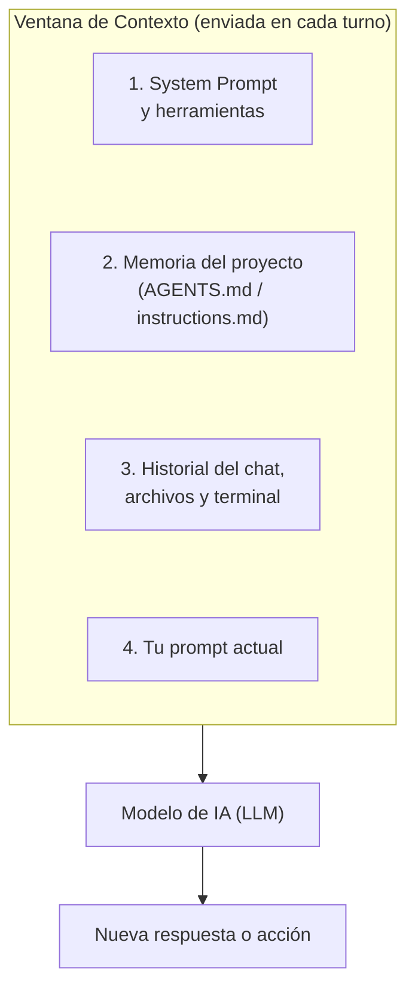
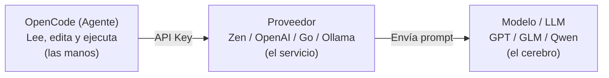

# 1. Conceptos básicos de IA para clase

Antes de instalar OpenCode y empezar a programar con asistentes de Inteligencia Artificial, es fundamental entender **cómo funciona realmente una IA por debajo**. No hace falta saber matemáticas avanzadas: basta con dominar 6 conceptos clave que te evitarán frustraciones, errores costosos y falsas expectativas durante todo el curso.

---

## 1. ¿Qué es un LLM (*Large Language Model*)?

Un **LLM** (*Modelo Grande de Lenguaje*, como GPT, Claude, Gemini, GLM, DeepSeek o Qwen) es un sistema entrenado con enormes cantidades de texto y código para **predecir qué secuencia de texto tiene más sentido generar a continuación** en función de lo que recibe como entrada.

!!! note "Lo más importante que debes saber"
    - **No es una base de datos ni un buscador:** No "consulta" un archivo guardado en su memoria cuando responde; calcula la respuesta más probable palabra a palabra.
    - **No es determinista:** Si envías exactamente el mismo mensaje dos veces (o a dos modelos distintos), puede darte soluciones diferentes aunque ambas funcionen.
    - **No tiene "conciencia" de tu ordenador:** Por sí solo, un modelo es únicamente un "cerebro" que recibe texto y devuelve texto.

---

## 2. ¿Qué es un *Token*?

Los modelos de IA no leen letras sueltas ni palabras completas tal como los humanos: dividen el texto en fragmentos llamados **tokens**.

- En español, **1 token equivale aproximadamente a 3–4 caracteres** (o unas 0,75 palabras).
- En código fuente, los símbolos, llaves, espacios e indentación también consumen tokens.

### Ejemplo visual de tokenización

La frase:
```text
Hola mundo, vamos a programar con OpenCode.
```
El modelo no la ve como 7 palabras, sino en piezas similares a:
`["Hola", " mundo", ",", " vamos", " a", " program", "ar", " con", " Open", "Code", "."]` &rarr; **~11 tokens**.

### ¿Por qué te importan los tokens en clase?

1. **Son la unidad de cobro:** Los proveedores de IA cobran por millón de tokens procesados, distinguiendo entre:
   - **Tokens de entrada (*Input*):** Todo lo que le envías al modelo (tu pregunta, el historial, los archivos que lee).
   - **Tokens de salida (*Output*):** Todo lo que el modelo genera en su respuesta (suele costar más que el *input*).
2. **Son la unidad de capacidad:** En la barra lateral de OpenCode verás indicadores como `10.7K (5%)` y `$0.02`. Significa que tu conversación actual ocupa 10.700 tokens (un 5 % de la capacidad máxima del modelo).

---

## 3. ¿Qué es el *Contexto* (*Context Window*)?

La **ventana de contexto** es la **memoria de trabajo temporal** (como una mesa de escritorio o la memoria RAM) que el modelo puede ver **en el instante exacto** en que genera una respuesta.

### Los LLMs son *stateless* (sin memoria entre mensajes)

Un error muy común al empezar es pensar que la IA "recuerda" la conversación como una persona. En realidad, los modelos son **stateless** (*sin estado*): **olvidan todo en cuanto terminan de responder**.

Para dar la sensación de conversación continua, cada vez que pulsas ++enter++, OpenCode vuelve a enviarle al modelo **todo el paquete completo**:



### ¿Qué pasa cuando el contexto crece demasiado? (La "zona tonta")

Aunque un modelo anuncie una ventana gigante (por ejemplo, `200K` tokens), llenar demasiado la mesa de trabajo con código antiguo, errores ya resueltos o cambios de tema provoca **degradación del contexto** (*context rot*):

- El modelo entra en lo que en la práctica se llama la **"zona tonta"**: pierde precisión, olvida instrucciones del principio o empieza a cometer errores básicos.
- Además, cada nuevo mensaje cuesta más tokens y tarda más en responder.

!!! warning "Regla práctica para todo el curso"
    Intenta mantener el uso de contexto **por debajo del 45–50 %**.
    - Si cambias de tarea &rarr; abre una **sesión nueva** (`/new` o ++ctrl+x++ ++n++).
    - Si necesitas seguir la misma tarea larga &rarr; usa **`/compact`** para resumir el historial.

---

## 4. *Prompt*, *System Prompt* y Memoria de Proyecto

En OpenCode conviven tres niveles de instrucciones que guían al modelo:

| Concepto | ¿Quién lo escribe? | ¿Para qué sirve? |
| :--- | :--- | :--- |
| **System Prompt** | OpenCode (automático) | Define el rol del asistente y cómo debe usar sus herramientas. |
| **Memoria / Instrucciones** (`instructions.md`, `AGENTS.md`) | Tú o `/init` (persistente) | Reglas fijas de tu estilo o de tu proyecto (idioma, stack, convenciones) que se cargan al iniciar cada sesión. |
| **User Prompt** | Tú en cada mensaje | La petición concreta que quieres resolver ahora (ej. *"Cambia el color de fondo de `@index.html`"*). |

!!! tip "Prompt claro = mejor resultado"
    Cuanto más específico sea tu prompt (indicando archivos con `@`, restricciones y resultado esperado), menos tendrá que adivinar el modelo.

---

## 5. Proveedor, Modelo, API Key y Agente (¿Qué es OpenCode?)

Muchos alumnos confunden estas cuatro piezas al principio. Esta analogía lo deja cristalino:



- **Modelo (el cerebro):** La IA concreta que razona y escribe código (ej. `GLM-5.2`, `Big Pickle`, `GPT-5.4`).
- **Proveedor (el servicio):** La plataforma donde vive el modelo (ej. `OpenCode Zen`, `OpenCode Go`, `OpenAI`, `Ollama`).
- **API Key (la llave):** Una clave privada que demuestra al proveedor quién eres para autorizar tus peticiones. **Nunca la subas a GitHub.**
- **Agente / OpenCode (las manos):** Un LLM en un chat web solo puede darte texto para que tú copies y pegues. Un **agente** como OpenCode le conecta **herramientas (*Tools*)** al modelo para que pueda leer carpetas, buscar texto, editar archivos y ejecutar comandos de terminal con tu supervisión.

### Dos términos extra que verás pronto

- **Multimodalidad:** Capacidad de un modelo para entender algo más que texto (por ejemplo, imágenes o capturas de pantalla). No todos los modelos gratuitos son multimodales.
- **Nube vs Local:** Los modelos en la nube se ejecutan en servidores externos (requieren internet y suelen ser más potentes); los modelos locales (como con **Ollama**) se ejecutan en tu propio ordenador (privacidad total, sin costo, pero dependen de tu RAM y tarjeta gráfica).

---

## 6. Comparativa de principales modelos, suscripciones y costos

En el mundo de la IA existen **dos formas de pagar** que conviene distinguir desde el primer día:

- **Suscripción mensual (consumidor):** Pagas una cuota fija al mes (por ejemplo, $20/mes) para usar el chat web/app y, en algunos proveedores, herramientas integradas dentro de unos límites de uso.
- **Pago por uso vía API (*Pay-as-you-go*):** No hay cuota fija; pagas exactamente por cada **millón de tokens (1M)** de entrada (*input*) y salida (*output*) que consumes. Es la forma habitual de conectar agentes externos o automatizaciones.

!!! info "Precios orientativos"
    Las tarifas y nombres de modelos evolucionan con frecuencia. Los importes de esta tabla sirven como **referencia práctica para clase** (en USD) y conviene comprobar siempre la página oficial del proveedor antes de contratar.

### Tabla comparativa general

| Proveedor / Familia | Modelos principales | Suscripción mensual típica | Costo API aprox. (por 1M tokens) | Destaca por... |
| :--- | :--- | :--- | :--- | :--- |
| **OpenAI (ChatGPT)** | **GPT-6.2 Astra** (razonamiento)<br/>**GPT-6.2 Sol** (uso diario)<br/>**GPT-6.1 Terra** (visión/rápido)<br/>**GPT-6 Luna** (económico)<br/>*(anteriores: GPT-5.4)* | **Gratis** (limitado)<br/>**Plus:** $20/mes<br/>**Pro:** $100 – $500/mes | **Entrada:** $2 – $10+<br/>**Salida:** $10 – $50+ | Ecosistema muy maduro, excelente razonamiento y compatible con OpenCode usando tu cuenta Plus/Pro (OAuth). |
| **Anthropic (Claude)** | **Claude Haiku** (rápido)<br/>**Claude Sonnet** (equilibrado)<br/>**Claude Opus** (máxima profundidad) | **Gratis** (limitado)<br/>**Pro:** $20/mes<br/>**Max / Ultra:** $100 – $200/mes | **Haiku:** ~$0.10 / $0.50<br/>**Sonnet:** ~$2–3 / $10–15<br/>**Opus:** ~$4–5 / $20–25 | Altísima calidad en programación, refactorización y seguimiento de instrucciones largas. |
| **Google Gemini** | **Gemini 3.8 Flash / Flash-Lite** (velocidad y bajo costo)<br/>**Gemini 4 Pro / Neon / Carbon** (razonamiento y código avanzado) | **Gratis** (cuotas diarias)<br/>**AI Plus:** ~$5/mes<br/>**AI Pro:** ~$20/mes<br/>**AI Ultra:** desde ~$100/mes | **Flash:** ~$0.75–1.50 / $3.75–7.50<br/>**Pro:** ~$2–4 / $10–20 | Ventanas de contexto muy amplias (~1M+ tokens), excelente multimodalidad (texto, imagen, audio, vídeo) e integración con Google Workspace. |
| **DeepSeek** | **DeepSeek Flash (`V4.1-Flash`)** (económico y ágil)<br/>**DeepSeek Pro (`V4-Pro`)** (razonamiento y código) | **Chat web/app gratis**<br/>Sin suscripción obligatoria (pago por uso en API) | **Flash:** ~$0.15–0.30 / $0.60–1.20<br/>**Pro:** ~$0.66–1.32 / $1.98–3.96 | Relación **calidad/precio imbatible** en API, descuentos del 50 % en horario *off-peak* y *prompt caching* muy barato. |
| **OpenCode Zen / Go** *(usados en el curso)* | **Zen Free:** `Big Pickle`, `MiMo V2.5 Free`<br/>**Go:** `GLM-5.2`, `DeepSeek`, `Qwen3.7`, `Kimi K2.7` | **Zen:** modelos `Free` gratis<br/>**Go:** $5 primer mes, luego $10/mes | Pago por uso en modelos no gratuitos de Zen | Acceso unificado y económico a modelos *open-source* potentes para programación. |
| **Ollama (Local)** | **Qwen 3.5**, **Llama**, **DeepSeek** (en tu propio PC) | **$0 (100 % Gratis)** | $0 (solo tu electricidad/hardware) | Privacidad total y trabajo sin internet (requiere buena RAM y GPU). |

### Detalle rápido por proveedor

=== "OpenAI (ChatGPT)"

    - **Modelos principales:**
        - **GPT-6.2 Astra (`gpt-6.2-astra`):** el modelo más potente para razonamiento complejo, agentes y programación avanzada.
        - **GPT-6.2 Sol (`gpt-6.2-sol`):** equilibrio entre inteligencia y velocidad para el día a día.
        - **GPT-6.1 Terra (`gpt-6.1-terra`):** optimizado para razonamiento visual rápido y texto natural.
        - **GPT-6 Luna (`gpt-6-luna`):** opción económica y rápida para tareas ligeras o de gran volumen.
        - *(En vídeos anteriores del curso también verás referencias a la familia **GPT-5.4**.)*
    - **Suscripciones:** **ChatGPT Plus ($20/mes)** para uso diario y **ChatGPT Pro ($100–$500/mes)** para cargas intensivas con límites ampliados.
    - **Uso con OpenCode:** Si ya pagas Plus o Pro, conéctalo mediante **inicio de sesión en navegador (OAuth)** y **no** por API Key manual, para evitar cargos extra por token.

=== "Anthropic (Claude)"

    - **Modelos principales:**
        - **Claude Haiku:** el más rápido y económico para tareas sencillas.
        - **Claude Sonnet:** el equilibrio ideal para programar a diario.
        - **Claude Opus:** máxima profundidad de razonamiento y arquitectura.
    - **Suscripciones:** **Claude Pro ($20/mes)**, **Claude Max ($100/mes)** y **Claude Ultra ($200/mes)**.
    - **Uso con OpenCode:** **No conectes tu suscripción personal de Claude a OpenCode** (Anthropic puede bloquear cuentas personales usadas desde clientes de terceros). Si necesitas Claude en agentes externos, debe hacerse exclusivamente mediante API oficial de plataforma.

=== "Google Gemini"

    - **Modelos principales:**
        - **Gemini 3.8 Flash / Flash-Lite:** alta velocidad, baja latencia, multimodalidad nativa (texto, imagen, audio, vídeo y PDFs) y ventanas de contexto enormes (~1M+ tokens).
        - **Gemini 4 Pro / Neon / Carbon:** gama de razonamiento profundo pensada para lógica de programación compleja y tareas de nivel avanzado.
    - **Suscripciones:** **Google AI Plus (~$5/mes)**, **Google AI Pro (~$20/mes)** y **Google AI Ultra (desde ~$100/mes)**, con integración en herramientas de Google y cuotas ampliadas.
    - **Punto fuerte:** Excelente capacidad multimodal y descuentos importantes en API mediante *Context Caching* y *Batch API* (50 %).

=== "DeepSeek"

    - **Modelos principales:**
        - **DeepSeek Flash (`deepseek-flash` / `V4.1-Flash`):** muy rápido y extremadamente económico.
        - **DeepSeek Pro (`deepseek-v4-pro`):** enfocado en razonamiento avanzado y programación.
    - **Suscripciones:** El chat web/móvil es gratuito; para desarrolladores funciona por **API de pago por uso** sin cuota mensual fija.
    - **Punto fuerte:** Tarifas de API drásticamente más bajas que los modelos propietarios tradicionales, con **50 % de descuento en horario *off-peak*** (fines de semana y franjas fuera de hora punta UTC) y lectura de caché de contexto por céntimos.

!!! tip "¿Qué recomiendo para empezar en clase?"
    Si estás empezando desde cero, **no necesitas gastar dinero**: usa los modelos gratuitos de **OpenCode Zen (`Free`)** o prueba **Ollama** en local si tienes buen ordenador. Si ya pagas **ChatGPT Plus**, aprovéchalo por OAuth; y si buscas una suscripción barata enfocada a programar en OpenCode, **OpenCode Go ($5–$10/mes)** ofrece acceso muy rentable a modelos *open-source* como DeepSeek, GLM y Qwen.

---

## 7. Alucinaciones y el rol del desarrollador

Una **alucinación** ocurre cuando el modelo inventa un dato, una función, una librería o un comportamiento que **no existe**, pero lo explica con total seguridad y tono convincente.

!!! danger "La regla número 1 de este curso"
    La IA es un **amplificador de tu criterio**, nunca un piloto automático ciego:

    - Lee siempre los cambios propuestos (por ejemplo, con `git diff`).
    - Prueba el código que genera antes de darlo por bueno.
    - Cuando haces *commit*, **el responsable de ese código eres tú**, no el modelo.

---

## 8. Glosario exprés de bolsillo

| Término | Definición en una frase |
| :--- | :--- |
| **LLM** | Modelo de IA entrenado para predecir y generar texto/código. |
| **Token** | Fragmento de texto (~3–4 caracteres en español) con el que la IA mide tamaño y costo. |
| **Contexto** | Toda la información (instrucciones + historial + archivos) que el modelo recibe en un turno. |
| **Stateless** | El modelo no guarda memoria entre mensajes; el cliente reenvía el historial cada vez. |
| **Prompt** | Instrucción o pregunta que envías al modelo. |
| **Agente** | Software (como OpenCode) que da al LLM herramientas para leer/editar archivos y ejecutar comandos. |
| **Alucinación** | Respuesta falsa o inventada que el modelo presenta como si fuera cierta. |

---

## Autocomprobación rápida para clase

??? question "1. Si llevas 40 minutos en el mismo chat y el contexto supera el 60 %, ¿qué deberías hacer al empezar una tarea nueva?"
    Abrir una **sesión nueva** (`/new` o ++ctrl+x++ ++n++). Así el modelo parte con la ventana de contexto limpia, gasta menos tokens y evita la pérdida de precisión de la "zona tonta".

??? question "2. ¿Qué diferencia hay entre usar ChatGPT en el navegador y usar OpenCode en la terminal?"
    El chat web solo te devuelve texto; **OpenCode es un agente** que conecta el modelo con herramientas de tu proyecto para leer archivos reales, aplicar ediciones, consultar Git y ejecutar comandos bajo tu control.

??? question "3. ¿Por qué un mismo prompt puede generar código distinto en dos pruebas?"
    Porque los LLMs son **probabilísticos (no deterministas)** y además cada modelo ha sido entrenado de forma diferente y depende del contexto disponible en ese momento.
