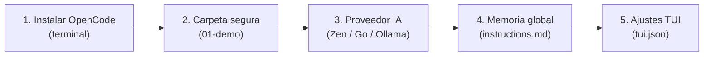

# 02. OpenCode - Instalación y configuraciones

!!! abstract "Objetivo del módulo"
    Dejar **OpenCode** completamente instalado, conectado a uno o varios proveedores de Inteligencia Artificial y configurado a tu gusto (reglas globales de programación, tema visual y alertas de sonido), partiendo desde **nivel cero**.

Si nunca has trabajado con un agente de codificación en terminal, no te preocupes: en este módulo no vamos a programar aplicaciones todavía, sino a **preparar tu entorno de trabajo** paso a paso.

## Conceptos básicos antes de empezar

Antes de ejecutar comandos, conviene tener claros cuatro términos que aparecerán en todo el módulo:

| Término | ¿Qué es? (Explicado fácil) |
| :--- | :--- |
| **Terminal / Consola** | La ventana donde escribes comandos de texto para comunicarte con tu ordenador (PowerShell/WSL en Windows, Terminal/Warp en macOS o Linux). |
| **TUI** (*Terminal User Interface*) | Una interfaz visual interactiva que vive **dentro de la terminal**. Parece una aplicación normal (puedes hacer clic y usar atajos), pero funciona en consola. |
| **LLM / Modelo** | El "cerebro" de IA que entiende tus peticiones y genera respuestas o código (por ejemplo: *Big Pickle*, *GPT*, *GLM-5.2*, *Qwen 3.5*). |
| **Proveedor** (*Provider*) | La plataforma o servicio que te da acceso a esos modelos, ya sea gratis, por suscripción o ejecutándolos en tu propio ordenador (*OpenCode Zen*, *OpenAI*, *OpenCode Go*, *Ollama*). |

## Ruta paso a paso del módulo

## Guías paso a paso incluidas

- [x] **[1. Instalación inicial y primeros pasos](01-instalacion-inicial.md)** — Cómo instalar OpenCode según tu sistema operativo, verificar la versión, crear una carpeta segura de pruebas, lanzar el TUI, cambiar el tema y hacer tu primer `ping`.
- [x] **[2. Proveedores y modelos de IA](02-proveedores-modelos.md)** — Cómo conectar **OpenCode Zen** (gratis), **OpenAI** (ChatGPT Plus/Pro), **OpenCode Go** y **Ollama** (modelos locales en tu PC), más qué NO debes conectar (Anthropic).
- [x] **[3. Instrucciones globales y memoria](03-instrucciones-globales.md)** — Dónde guarda OpenCode su configuración, cómo crear `opencode.jsonc` e `instructions.md` globales, cómo reiniciar sesiones con `opencode -c` y cómo resolver errores de sintaxis JSON.
- [x] **[4. Personalización del TUI (`tui.json`)](04-configuracion-tui.md)** — Cómo activar notificaciones de escritorio y sonidos cuando OpenCode termina una tarea o pide permiso, y resumen de atajos esenciales.
- [x] **[5. Batería de ejercicios (Módulo 02)](05-ejercicios.md)** — 8 ejercicios de dificultad incremental con pistas y soluciones ocultas que cubren instalación, proveedores, memoria global y `tui.json`.

??? note "Lecciones originales del módulo en la carpeta"
    1. `01. Introducción`
    2. `02. Temas puntuales`
    3. `03. OpenCode - Instalación inicial`
    4. `04. Proveedores de modelos`
    5. `05. Proveedor - Modelos de OpenAI`
    6. `06. Proveedor - OpenCode Go`
    7. `07. Proveedor - Modelos de Ollama`
    8. `08. Instrucciones globales`
    9. `09. Configuraciones TUI.json`
    10. `10. Repaso interactivo: Instalación y configuraciones`
