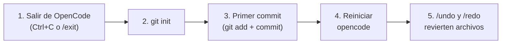

# 2. Comandos `/undo`, `/redo` y Git

Uno de los mayores miedos al trabajar con agentes de IA es: *"¿Y si le pido un cambio y me rompe el archivo?"*. OpenCode incluye `/undo` y `/redo` para viajar atrás y adelante en tus instrucciones, **pero tienen un requisito indispensable para funcionar sobre tu código**.

---

## 1. El problema sin Git: solo se revierte el chat

Si abres OpenCode en una carpeta que **no es un repositorio Git** y le pides una serie de cambios sobre `index.html`, por ejemplo:

1. `Cambia el color de fondo de @index.html a un azul pastel` (ej. `#aec6cf`).
2. `Cambia el color de fondo de @index.html a un rosa pastel` (ej. `#f4c2c2`).
3. `Cambia el color de fondo de @index.html a un morado pastel` (ej. `#c3b1e1`).
4. `Cambia el color de fondo a azul pastel`.

Al ejecutar `/undo` (o el atajo ++ctrl+x++ ++u++), OpenCode mostrará `1 message reverted`, **pero al mirar `index.html` comprobarás que el código en disco NO ha cambiado**. Sin control de versiones, `/undo` únicamente deshace los mensajes en el historial de la conversación.

---

## 2. Solución paso a paso: inicializar Git

Para que OpenCode pueda rastrear instantáneas (*snapshots*) reales de tus archivos y revertir ediciones en disco, sigue exactamente estos pasos:



=== "Terminal"

    ```bash
    # 1. Inicializa el repositorio en 01-demo
    git init

    # 2. Prepara todos los archivos actuales
    git add .

    # 3. Crea el commit inicial
    git commit -m "first commit"

    # 4. Vuelve a iniciar OpenCode
    opencode
    ```

=== "VS Code / Cursor (Source Control)"

    1. Ve a la pestaña **Source Control** en la barra lateral.
    2. Haz clic en **Initialize Repository**.
    3. Escribe el mensaje `"first commit"` y haz clic en **Commit**.
    4. Cierra OpenCode y vuelve a ejecutar `opencode` en la terminal para que detecte el repositorio recién creado.

!!! warning "Es obligatorio reiniciar OpenCode tras `git init`"
    Si inicializas Git mientras OpenCode ya está abierto, la sesión actual no activará la reversión de archivos hasta que salgas y vuelvas a ejecutar `opencode`.

---

## 3. Práctica: `/undo` y `/redo` funcionando sobre archivos

Con Git activo y un *commit* inicial limpio, repite la secuencia de prompts sobre `index.html`:

1. `Cambia el color de fondo de @index.html a rosa pastel` &rarr; aplica `#f8c8d8`.
2. `Cambia el color de fondo de @index.html a morado pastel` &rarr; aplica `#d8b4e2`.
3. `Cambia el color de fondo a verde pastel` &rarr; aplica `#b4e2b4`.
4. `Cambia el color de fondo a morado pastel` &rarr; aplica `#d8b4e2`.

### Retroceder con `/undo` (++ctrl+x++ ++u++)

Al ejecutar `/undo` o presionar ++ctrl+x++ ++u++:

- OpenCode indica el número de mensajes revertidos y el resumen de cambios restaurados en disco, por ejemplo:

```text
1 message reverted
ctrl+x r or /redo to restore

index.html +1 -1
```

- Al abrir `index.html`, verás que el color de fondo regresa inmediatamente al paso anterior (`#b4e2b4` verde pastel, luego `#d8b4e2`, luego `#f8c8d8`), y además **tu prompt vuelve a aparecer en la caja de texto** por si quieres corregirlo y reenviarlo.

### Avanzar con `/redo` (++ctrl+x++ ++r++)

Si retrocediste demasiado, ejecuta `/redo` o presiona ++ctrl+x++ ++r++ para rehacer el cambio paso a paso.

!!! note "Cómo saber que ya estás en el último cambio"
    Cuando sigas presionando ++ctrl+x++ ++r++ y ya no queden pasos por rehacer, la letra `r` aparecerá escrita en el prompt (o `/redo` dejará de mostrarse en el autocompletado) porque ya llegaste al estado más reciente.

---

## 4. Advertencia crítica: `/undo` NO sustituye a Git

!!! danger "No uses `/undo` como tu sistema de respaldo"
    Como se recalca en el curso, `/undo` y `/redo` dependen de la sesión activa de OpenCode. Si purgas o borras una sesión, o si mezclas muchos cambios grandes, **pierdes esa línea temporal**.
    En proyectos reales, trabaja siempre con **commits frecuentes y ramas de Git** para tener un historial permanente, auditable y controlado.
