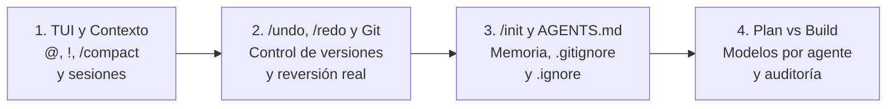

# Módulo 3: OpenCode 101 — Primeros pasos

En este módulo darás el salto desde la instalación inicial hacia el **uso real y cotidiano de OpenCode en la terminal (TUI)** sobre un proyecto práctico. Aprenderás a navegar con fluidez por la interfaz, entender cómo se comporta la memoria (*contexto*) de un modelo de IA, deshacer cambios de forma segura con Git, documentar tu repositorio con `AGENTS.md`, proteger carpetas con `.ignore` y planificar funcionalidades antes de escribir una sola línea de código.

!!! info "Recursos oficiales del módulo"
    - **Repositorio de código fuente del módulo:** [DevTalles-corp/opencode-primeros-pasos](https://github.com/DevTalles-corp/opencode-primeros-pasos)
    - **Gist del `README.md` usado en `/init`:** [Gist — Readme.md](https://gist.github.com/Klerith/a4d015f6cd9c94bc0d14cfb8c5722a31)
    - **Documentación oficial de herramientas e ignore:** [OpenCode Docs — Tools & Internals](https://opencode.ai/docs/tools/#internals)

---

## Mentalidad clave antes de empezar

Antes de tocar un solo comando, conviene tener claras dos ideas fundamentales que marcan la diferencia entre usar IA como un juguete o como una herramienta profesional de ingeniería:

1. **La IA es un amplificador, no un reemplazo:** Si ya conoces fundamentos de desarrollo (HTML, CSS, Git, arquitectura, lectura de errores), OpenCode multiplica tu velocidad. Si no entiendes lo que genera, solo multiplicarás la confusión.
2. **Tu criterio crítico es obligatorio:** El responsable final de cada línea que entra en tu repositorio eres tú, no el modelo. Nunca apruebes ni hagas *commit* de cambios que no hayas revisado con `git diff`.

!!! warning "Usa la terminal (TUI) como entorno principal"
    Muchos atajos, comandos `/` y comportamientos descritos en este módulo (como la referencia física con `@`, el modo Shell con `!`, o el control fino de `/undo` y `/redo`) están diseñados para la **TUI en consola** y no funcionan igual en la aplicación de escritorio ni en la extensión de VS Code.

---

## Mapa de lecciones del módulo

| Guía | Contenido principal | Comandos y atajos clave |
| :--- | :--- | :--- |
| [1. TUI, navegación y gestión del contexto](01-tui-y-contexto.md) | Creación de `01-demo/index.html`, barra `/`, referencias `@`, modo Shell `!`, panel lateral, límite del 45–50 %, `/compact` y sesiones | `/`, `@`, `!`, `++ctrl+p++`, `++ctrl+u++`, `++ctrl+w++`, `++ctrl+x++ ++b++`, `/compact`, `opencode -c` |
| [2. Comandos `/undo`, `/redo` y Git](02-undo-redo-git.md) | Por qué `/undo` solo revierte mensajes sin Git, inicialización de Git paso a paso, pruebas con colores pastel en `index.html` | `git init`, `/undo` (`++ctrl+x++ ++u++`), `/redo` (`++ctrl+x++ ++r++`) |
| [3. `/init`, `AGENTS.md` y patrones a ignorar](03-init-agents-ignore.md) | Uso de `README.md` previo a `/init`, generación y mantenimiento de `AGENTS.md`, diferencia práctica entre `.gitignore` y `.ignore` | `/init`, `@style-guide.md`, `.gitignore`, `.ignore` |
| [4. `Plan Mode`, `Build Mode` y comparación de modelos](04-plan-mode-y-agentes.md) | Cambio entre modo lectura (`Plan`) y escritura (`Build`), asignación de modelos por agente, instalación de Tailwind Play CDN y revisión con `git diff` | `++tab++`, `/models`, `git diff`, `git log` |
| [5. Batería de ejercicios (Módulo 03)](05-ejercicios.md) | 9 ejercicios de dificultad incremental con pistas y soluciones ocultas cubriendo TUI, contexto, `/compact`, `/undo` con Git, `/init`, `.ignore`, `Plan Mode` y auditoría | Todos los comandos y atajos del módulo |

---

## Checklist de dominio del módulo

- [ ] Crear un proyecto demo (`01-demo/index.html`) y abrir OpenCode dentro de su carpeta raíz.
- [ ] Dominar la TUI: comandos `/`, paleta `++ctrl+p++`, referencias físicas `@archivo`, modo Shell `!` y barra lateral `++ctrl+x++ ++b++`.
- [ ] Mantener el contexto por debajo del **45–50 %** usando sesiones nuevas (`++ctrl+x++ ++n++`) o `/compact` cuando sea necesario continuar la misma tarea.
- [ ] Inicializar Git (`git init` + primer *commit*) para que `/undo` y `/redo` reviertan tanto mensajes como cambios en archivos.
- [ ] Generar `AGENTS.md` con `/init` a partir de un `README.md` claro y restringir archivos sensibles o pesados con `.gitignore` y `.ignore`.
- [ ] Planificar en `Plan Mode` (solo lectura) antes de ejecutar en `Build Mode`, y auditar siempre los cambios finales con `git diff`.
