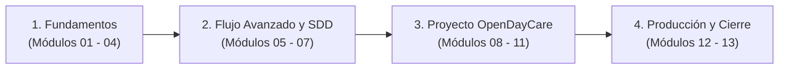

# OpenCode: Guía Completa para Desarrolladores

!!! info "Propósito de esta documentación"
    Este sitio reúne los materiales de estudio, guías prácticas, comandos y resúmenes del curso **OpenCode: Guía completa para desarrolladores de software**, organizados por módulos y optimizados para publicarse con **Zensical**.

## Ruta del curso



## Bloques principales

<div class="grid cards" markdown>

-   :material-rocket-launch:{ .lg .middle } **Bloque 1 · Fundamentos**

    ---

    Instalación, proveedores de modelos, `tui.json`, comandos esenciales de OpenCode y construcción de una *Weather App* de consola con CI en GitHub Actions.

    [:octicons-arrow-right-24: Ir al Módulo 01](01-introduccion/index.md)

-   :material-source-branch:{ .lg .middle } **Bloque 2 · Flujo Avanzado y SDD**

    ---

    Git Worktrees con *Asteroids*, comandos personalizados, integración con GitHub, metodología **Spec Driven Development (SDD)**, Skills, MCPs y agentes personalizados.

    [:octicons-arrow-right-24: Ir al Módulo 05](05-worktrees-comandos/index.md)

-   :material-application-brackets:{ .lg .middle } **Bloque 3 · Proyecto OpenDayCare**

    ---

    Maquetación, referencias y esquemas con **Supabase**, automatizaciones en paralelo, CRON jobs y metodologías **Grill Me** y **OpenSpec**.

    [:octicons-arrow-right-24: Ir al Módulo 08](08-maquetacion-opendaycare/index.md)

-   :material-cloud-upload:{ .lg .middle } **Bloque 4 · Despliegue y Cierre**

    ---

    Aprovisionamiento de base de datos, configuración en **Vercel**, migración de datos y usuarios, verificación en producción y cierre del curso.

    [:octicons-arrow-right-24: Ir al Módulo 12](12-produccion/index.md)

</div>

## Mapa general de módulos

| # | Módulo | Enfoque principal | Estado |
| :-: | :--- | :--- | :---: |
| 01 | [Introducción](01-introduccion/index.md) | Dinámica del curso, instalaciones previas y comunidad | <span class="badge-status badge-pending">Esquema base</span> |
| 02 | [Instalación y configuraciones](02-instalacion-configuraciones/index.md) | OpenCode CLI/TUI, proveedores (OpenAI, OpenCode Go, Ollama), `tui.json` | <span class="badge-status badge-pending">Esquema base</span> |
| 03 | [OpenCode 101 - Primeros pasos](03-opencode-101/index.md) | Gestión de contexto, `/compact`, `/undo`, `/redo`, `/init`, `Agents.md`, Plan mode | <span class="badge-status badge-pending">Esquema base</span> |
| 04 | [Aplicación de consola](04-aplicacion-consola/index.md) | Proyecto *Weather App*, pruebas automáticas y GitHub Actions | <span class="badge-status badge-pending">Esquema base</span> |
| 05 | [Worktrees y comandos personalizados](05-worktrees-comandos/index.md) | Git Worktrees (*Asteroids*), comandos propios e integración con GitHub | <span class="badge-status badge-pending">Esquema base</span> |
| 06 | [Spec Driven Development / Design](06-spec-driven-development/index.md) | Metodología SDD, Agent Skills y flujo de PRs (juego tipo Pac-Man) | <span class="badge-status badge-pending">Esquema base</span> |
| 07 | [MCPs y Agentes personalizados](07-mcps-agentes/index.md) | Playwright, Context7, Skills (`spec`, `spec-impl`), Spec Verifier en *OpenDayCare* | <span class="badge-status badge-pending">Esquema base</span> |
| 08 | [Maquetación de OpenDayCare](08-maquetacion-opendaycare/index.md) | Comandos continuos, login, activación, niños, padres y revisión de specs en GitHub | <span class="badge-status badge-pending">Esquema base</span> |
| 09 | [Referencias, esquemas y Supabase](09-referencias-supabase/index.md) | MCP de Supabase, tablas, conexión con Next.js, auth e invitaciones | <span class="badge-status badge-pending">Esquema base</span> |
| 10 | [Automatizaciones y agentes en paralelo](10-automatizaciones-paralelo/index.md) | Agentes especializados (React, DB Migrator, A11y, Auditor), formateadores y CRON | <span class="badge-status badge-pending">Esquema base</span> |
| 11 | [Metodologías Grill Me y OpenSpec](11-grill-me-openspec/index.md) | Grill Me + SDD y flujo completo con OpenSpec (`explore`, `new`, `apply`, `verify`, `archive`) | <span class="badge-status badge-pending">Esquema base</span> |
| 12 | [Producción](12-produccion/index.md) | Base de datos en producción, Vercel, migraciones y pruebas en vivo | <span class="badge-status badge-pending">Esquema base</span> |
| 13 | [Fin del curso](13-fin-del-curso/index.md) | Recursos adicionales, siguientes pasos y despedida | <span class="badge-status badge-pending">Esquema base</span> |

## Cómo usar y previsualizar estos apuntes

=== "Servidor local (Zensical)"

    Para previsualizar el sitio con recarga en vivo en tu navegador:

    ```powershell
    python -m zensical serve
    ```

=== "Compilar sitio estático"

    Para generar la versión estática lista para publicar en la carpeta `site/`:

    ```powershell
    python -m zensical build
    ```

=== "Convenciones de formato"

    En cada módulo aprovecharemos las capacidades de **Zensical**:

    - **Admonitions y detalles colapsables** (`!!!`, `???`) para notas, advertencias, tips y soluciones.
    - **Pestañas de contenido** (`===`) para comparar configuraciones, comandos o enfoques.
    - **Diagramas Mermaid** para visualizar flujos de trabajo entre agentes, Git y arquitectura.
    - **Anotaciones de código** y botones de copiado rápido.
    - **Checklists interactivos** (`- [ ]`) para seguir tu avance lección a lección.
    - **Atajos de teclado** renderizados como ++ctrl+k++ o ++tab++.
